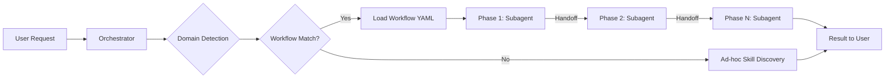

# ai-resources

Resource kit for AI coding agents: skills, workflows, orchestration rules, agent roles, and the **`ai-resources`** CLI. Works with **Cursor, Claude Code, Antigravity CLI (agy), Codex, GitHub Copilot, Windsurf, Continue.dev, Aider, and OpenCode**.

**v1.1 highlights:**
- **`--dry-run` for setup** — preview all generated configs and run live gateway smoke tests without writing anything to disk.
- **Teardown when switching modes** — multi-model → single-model (or vice versa) cleanly removes every artifact the wizard installed; pre-existing config is never touched.
- **OAuth + LiteLLM fix** — `allow_requests_on_db_unavailable: true` is auto-added to the gateway config so Claude Code OAuth session tokens pass through without a DB lookup error.
- **`quality-first` profile** — replaces `unified-default`; same routing strategy, clearer name.

**v1.0:** multi-model orchestration via LiteLLM — each subagent role can run on a different LLM (Claude, Gemini, GPT, Vertex, Ollama). See [docs/multi-model.md](docs/multi-model.md).

## Install

Requirement: **Homebrew**.

By default, Homebrew resolves `brew tap user/name` as `github.com/user/homebrew-name`, not `user/name`. That's why you must specify the actual repo URL:

```bash
brew tap wildbitca/ai-resources https://github.com/wildbitca/ai-resources.git
brew install ai-resources
```

Verify: `ai-resources --help`

**Upgrade:** `brew update && brew upgrade ai-resources`

The formula is in **`Formula/ai-resources.rb`**. It declares **`python@3.12`**; the kit binary is typically **`python3.12`** (not always `python3`). If `ai-resources --help` fails, try `brew reinstall python@3.12` and reinstall the kit.

## Usage

| Command | Purpose |
|---------|---------|
| `ai-resources setup` | Guided setup in five phases (Tools, Cockpit, Team, Audio, More; the Cockpit and Audio phases ask nothing unless OpenClaw is one of your tools). The screens are **Your tools** (every coding CLI is a tool; installed ones are found for you, tick a missing one to install it), **Sign-in** (each ticked tool shows what it reports live and asks keep or change; change hands the terminal to the tool's own flow: `claude auth login`, `openclaw configure --section model`, `agy`; the kit only adds an `apiKeyHelper` for Claude Code and never stores a key; there is no global team question and no gateway, ADR-0016), **Your team** (a starting team: Balanced, Performance, Low cost or Custom, with who does what) and **Review** (the answers, who runs each role and who is billed in separate columns, Apply, Change tools, Change sign-in, Change team, More options; every write the wizard queued is listed under *Will write* and happens only at Apply). Headers read `[n/5]` with a five-phase progress rail; `Ctrl-B` goes back where nothing changed yet, `Ctrl-C`/`Ctrl-D` cancel. `--dry-run` previews; `NO_COLOR` selects plain ASCII output. `ai-resources setup --help` lists the keys. |
| `ai-resources setup --ask` / `--fresh` | Since 2.8.0 setup takes the recommended answer to every question it has one for and prints one line per answer; credentials, a hand-over to a tool's own sign-in and the Google acknowledgement are still asked. A first run walks every step. `--ask` asks every question; `--fresh` asks every question starting from empty answers. `--auto` is accepted and is the default. |
| `ai-resources setup --backend ...` | **Deprecated** (ADR-0015): the gateway is no longer offered. Any value (`cli`, `litellm`, `openrouter`) pre-fills Claude Code's subscription sign-in, prints a deprecation note and skips that question. |
| `ai-resources orchestrate ...`, `ai-resources workflows {list,show}` | The native team orchestrator engine (ADR-0015): `start`, `next`, `report`, `approve`, `cancel`, `resume`, `status`, `cost`, all with `--json`. It never dispatches; the OpenClaw plugin does (`/equipo`, `/workflow run|status|approve|cancel|resume|cost`). See [docs/orchestration.md](docs/orchestration.md#native-team-orchestrator-openclaw). |
| `ai-resources setup --yes` | Say yes, for this run only, to installing the missing ones of Claude Code, Antigravity (`agy`) and OpenClaw. No other tool is installed by `--yes`; the tool list on a terminal offers every missing tool. |
| `ai-resources setup --dry-run` | Preview all generated configs as a masked unified diff and run smoke tests without writing anything to disk. |
| `ai-resources setup --lanes` / `--no-lanes` / `--lanes-dry-run` | Enable, clear or preview subscription lanes (ADR-0007; off by default). |
| `ai-resources setup --non-interactive` | Re-apply saved answers without prompting (useful in CI or scripted re-runs). |
| `ai-resources setup --profile <name>` | Skip the preset and profile prompts and use the named profile directly. |
| `ai-resources mcp-run <sentry\|figma>` | Start a shared-token MCP server (see [Shared-token MCP servers](#shared-token-mcp-servers)). Cockpits run it; you do not. |
| `ai-resources doctor` | Full health check across config, credentials, gateway, cockpits, smoke tests. |
| `ai-resources verify` | Read-only check that setup left every configured tooling in the expected state (`--json`, `--cockpit ID`); exits 1 only on an error-level finding. Setup ends by running it. |
| `ai-resources executors show` | Display current role → model mapping. |
| `ai-resources executors edit` | Open `executors.yaml` in `$EDITOR`. |
| `ai-resources executors test <role>` | Round-trip a single role's model through the gateway. |
| `ai-resources models status` | Effective Claude pins (kit default vs host overlay), config drift, pending approvals, last run. |
| `ai-resources models check [--refresh]` | Read-only: exit 0 nothing to do, 10 an approval is pending, 11 a change is ready. |
| `ai-resources models update [--check\|--dry-run] [--slot P:F] [--no-restart] [--unattended] [--review] [--apply-proposals]` | Find newer models for the providers you enabled and apply what the policy allows; on a terminal it shows what it found and asks (config patch, drained restart, health check, automatic rollback). |
| `ai-resources models {approve,revoke,pin,unpin,exclude,rollback}` | Policy and recovery for the model updates. See `docs/multi-model.md`. |
| `ai-resources daemon {start,stop,status,logs,update}` | Manage local LiteLLM container. |
| `ai-resources audit` | Cost report from gateway logs. |
| `ai-resources generate` | Regenerate skills index, import vendor skills. |
| `ai-resources version` | Print version. |

### First run

```sh
ai-resources setup       # wizard walks you through everything
ai-resources doctor      # verify
```

The wizard asks three things, in plain words: **which tools** you use (every AI coding CLI is a tool, Claude Code
included), **how they should work** (as a team on your subscriptions, each on its own, or Advanced: a LiteLLM or
OpenRouter gateway with API keys) and **who does what** (a starting team that gives each role to a tool). See the
[glossary](docs/multi-model.md#words-the-setup-uses) for the six words it uses.

The wizard shows a step header with a progress rail and key hints, takes Ctrl-B to go back in the steps that changed nothing yet, and ends with a review (Apply, Change tools, Change sign-in, Change team, More options) before the kit's configuration is written (earlier steps may already have installed tools or handed the terminal to a tool's own sign-in; a cancel lists them, and the hygiene, agy MCP, CLAUDE.md and operator-rules writes wait for Apply). Ctrl-C and Ctrl-D exit with code 130 and list anything already done. Details: [docs/multi-model.md](docs/multi-model.md#what-the-wizard-looks-like).

**Preview before committing:**
```sh
ai-resources setup --dry-run   # renders configs + runs smoke tests, writes nothing
```

**Switching modes later:**
Running `ai-resources setup` again and switching mode (e.g. multi-model → single-model) presents a confirmation list of tracked artifacts and removes only what the wizard installed. Pre-existing config files are never touched.

After installing, the `AGENT_KIT` env var points to the kit on disk. The wizard sets `AGENT_SKILLS_ROOT` automatically for each configured cockpit.

### Claude Code + OAuth

If Claude Code is in OAuth mode (`claude /login`), the wizard detects this and auto-adds `allow_requests_on_db_unavailable: true` to the LiteLLM gateway config. This lets Claude Code's session token pass through the local gateway without hitting a "db not found" error. Run `ai-resources doctor` to verify the setup is clean.

---

## What's in the Kit

### Directory Map

```
ai-resources/
├── skills/                 # 116 reusable skill modules (SKILL.md each)
│   ├── common-*            # Language-agnostic skills (best practices, security, TDD, etc.)
│   ├── flutter-*           # Flutter/Dart-specific skills
│   ├── terraform-*         # Terraform/IaC skills
│   ├── gpm-curated-*       # Imported curated skills (Gentleman Programming)
│   ├── gpm-community-*     # Imported community skills
│   └── _shared/            # Shared conventions and contracts
├── workflows/              # 16 workflow definitions (YAML) → generated workflow-* skills
├── hooks/                  # Claude Code hooks installed by setup (handoff guard, return format, stale handoffs)
├── profiles/               # Role → model profiles (claude-native/claude-inherit for single-model; LiteLLM profiles for multi-model)
├── agents/
│   ├── roles/              # 15 base agent roles (domain-agnostic)
│   └── personas/           # 25 domain-specific personas (role x domain)
├── rules/                  # Project-context and memory rules (.mdc format)
├── templates/              # 6 project templates (ADR, spec, etc.)
├── docs/                   # Guides (multi-model.md, orchestration.md, litellm-service.md)
├── scripts/
│   └── ai_resources/       # CLI package
│       ├── cli.py           # Argument parser + command dispatch
│       ├── generate.py      # skills-index.json builder + vendor importer
│       ├── daemon.py        # LiteLLM container lifecycle
│       ├── doctor.py        # Health check
│       ├── executors_cmd.py # Role → model map management
│       ├── audit.py         # Cost report
│       └── setup/           # Interactive wizard
│           ├── wizard.py    # Main wizard loop (5 phases over 10 steps)
│           ├── state.py     # SetupState + InstallTracking (audit trail for teardown)
│           ├── credentials.py
│           ├── litellm.py   # litellm.yaml / docker-compose.yaml generation
│           ├── providers.py # Provider model lists
│           ├── profiles.py  # Profile loader
│           ├── smoke.py     # Live gateway smoke tests
│           ├── detection.py # Cockpit auto-detection
│           ├── ui.py        # Rich/questionary UI helpers
│           └── cockpits/    # Per-cockpit configurators (claude, gemini, cursor, …)
├── openclaw-plugin/
│   └── ai-resources/        # OpenClaw plugin: agy-cli + claude-kit CLI backends, /claude shortcut
│       ├── index.js         # Plain JS, no build step — linked via `openclaw plugins install --link`
│       └── bridge.py        # stdio MCP bridge agy uses to reach OpenClaw's tools
├── Formula/                # Homebrew formula
├── skills-index.json       # Auto-generated skill catalog (machine-readable)
├── resources.json          # Kit manifest (external skill sources, MCP config)
├── AGENTS.md               # Orchestration policy and skill discovery rules
└── CHANGELOG.md            # Release history
```

### Skills (`skills/`)

Each skill is a self-contained module with a `SKILL.md` file containing YAML frontmatter (`name`, `description`, `triggers`, `globs`) and detailed instructions. Skills are the primary unit of knowledge in the kit.

**Discovery:** `ai-resources setup` links each skill into the agent's native skills directory (`~/.claude/skills/<id>`, `~/.agents/skills/<id>`), so agents see every skill's description and load a skill only when it matches. Tools without native skill discovery use `skills-index.json` (generated by `ai-resources generate`, paths relative to the kit root).

**Categories:**

| Prefix | Count | Domain |
|--------|-------|--------|
| `common-*` | ~25 | Language-agnostic (security, TDD, code review, architecture, etc.) |
| `flutter-*` | ~30 | Flutter/Dart development |
| `dart-*` | 3 | Dart language, tooling, best practices |
| `terraform-*` | 5 | Terraform/IaC modules, versioning, migrations |
| `gpm-curated-*` | 14 | Imported: Angular, React, Next.js, TypeScript, etc. |
| `gpm-community-*` | 6 | Imported: Electron, Elixir, Java, Spring Boot, etc. |
| Other | ~30 | Specialized (Cloudflare, Firebase, Sentry, ClickUp, etc.) |

### Workflows (`workflows/`)

Workflow YAML files define multi-phase execution pipelines. Each phase specifies a subagent type and the skills it should load. `ai-resources generate` exposes each workflow as a `workflow-<name>` skill whose description is the workflow's trigger, so agents pick workflows through native skill discovery; the `kit-orchestration` skill explains how to run them. See [Orchestration Guide](docs/orchestration.md) for diagrams.

Workflows: `feature-implementation`, `bugfix`, `refactor`, `explore-and-plan`, `cross-domain-backend-infra`, `merge-and-document`, `release-dart-flutter`, `security-devsecops`, `dependency-audit`, `ci-debug`, `incident-response`, `infra-triage`, `k8s-debug`, `log-triage`, `db-investigation`, `cloud-ops`.

### Deterministic core loop (`workflows/scripts/`)

Feature, bugfix and refactor work also ships as two [dynamic workflow](https://code.claude.com/docs/en/workflows) scripts, installed by setup into `~/.claude/workflows/`:

| Command | What it runs |
|---------|--------------|
| `/kit-plan <goal>` | Parallel readers (code, specs, tests and risk) → three planners with different biases → two judges → one plan file for you to approve |
| `/kit-implement` | One writer implementing with TDD → test gate with a bounded fix loop → three review lenses in parallel (correctness, security, test integrity) → a skeptic per finding → fix what survives → verifier signs off against the acceptance criteria |

The script holds the ordering, retries and fan-out, so they don't depend on the model following prose. A script can't ask you anything while it runs, which is why approval sits between the two commands.

### Profiles (`profiles/`)

Profiles define the role → model mapping for kit subagents. Setup offers the profiles that match the chosen mode.

| Profile | Mode | Strategy |
|---------|------|----------|
| `balanced`, `performance`, `low-cost` | single-model | The three starting teams of "Your team" on every row without a gateway (Claude aliases, a lane table; Balanced also names Gemini over Antigravity, held until the gates are proven) |
| `claude-native` | single-model | Claude aliases per role (kept for saved setups; its preset is Balanced) |
| `claude-inherit` | single-model | Every role inherits the session model |

`balanced` (single-model) is the performant and low-cost mix, retuned on 2026-10-22 (ADR-0014): Haiku 5.5 for explore, tester, doc-writer and package-upgrade; Sonnet 5.5 for the planner, architect, implementer, reviewer and the fixers; Opus 5.5 for the verifier and security auditor only (no writer on Opus, no fallback to Opus). A host that saved `balanced` sees the old -> new table at its next `setup`; nothing is renamed and `low-cost` keeps its team.

The starting-team ids are the same on every row: `balanced`, `performance`, `low-cost` (and Custom). A gateway row uses `gateway/balanced` (Claude Opus checkers, Sonnet writers, Gemini Flash on explore, tester and doc-writer; Review asks once whether to use Gemini through OpenRouter), `gateway/performance` and `gateway/low-cost`. Old names keep loading and mean the same team (`performance-claude-55` is `gateway/performance`, ...). `subscription-claude-55` is a legacy preset, not an alias: it keeps its own file and its Claude-only team. A checker (verifier, security-auditor) never shares a model family with a writer in any shipped profile; `claude-inherit` and `all-gemini` are the two open exceptions.

Multi-model (gateway) profiles:

| Profile | Strategy |
|---------|----------|
| `quality-first` | Balanced quality/cost — strong models for plan/review, fast models for exploration |
| `all-claude` | Every role uses a Claude model (Anthropic only) |
| `all-gemini` | Every role uses a Gemini model |
| `cost-optimized` | Cheapest viable model per role |

### Agent Roles (`agents/roles/`)

Base role definitions that tell subagents how to behave. Each role has a specific responsibility boundary.

| Role | Responsibility |
|------|---------------|
| `generalPurpose` | Multi-step reasoning, research, exploration |
| `planner` | Requirements analysis, task breakdown, acceptance criteria |
| `software-architect` | Architecture validation, design decisions, diagrams |
| `implementer` | Code changes — atomic edits following the plan |
| `tester` | Write and run tests, coverage analysis |
| `code-reviewer` | Code review against standards and security |
| `security-auditor` | SAST, DAST, dependency scanning, exploit validation |
| `verifier` | Final validation, spec updates, SDD closure |
| `doc-writer` | Specs, ADRs, postmortems from verified sources |
| `explore` | Codebase discovery and pattern finding |
| `terraform-maintainer` | Terraform module lifecycle |
| `crashlytics-fixer` | Firebase Crashlytics triage |
| `sentry-fixer` | Sentry error triage |
| `package-upgrade` | Dependency upgrade workflow |
| `crossplane-upjet-maintainer` | Crossplane infrastructure |

### Agent Personas (`agents/personas/`)

Domain-specific variants combining a role with a technology domain. For example, `implementer-dart-flutter.md` is an implementer specialized in Flutter. Available domains: **angular**, **api-platform**, **dart-flutter**, **devops**, **symfony**.

### Rules (`rules/`)

Project-context, memory and security rules in `.mdc` format (`000-project-bootstrap`, `012`/`013` specs entry, `014`/`300` Engram, `017` multi-model routing, `200` MCP security). Orchestration moved to skills:

- `kit-orchestration` — running workflow steps, delegation, handoff, parallel groups, subagent return format
- `delegate`, `setup-project`, `self-update`, `knowledge-audit` — slash commands

### Hooks (`hooks/`)

Installed into `~/.claude/settings.json` by setup (your own hooks are kept):

- `kit_session_start.py` (SessionStart) — reports in-progress or stale `.agent-output/handoff-*.md` files
- `kit_subagent_return.py` (SubagentStop) — during a workflow, sends a kit role subagent back if it did not end with the return block
- `kit_handoff_guard.py` (PreToolUse) — while `.agent-output/parallel-group.json` exists, blocks subagents from writing the shared handoff
- `kit_sleep_guard.py` (PreToolUse, Bash) — refuses a `sleep` longer than 30 seconds (exit 2) and points at `run_in_background` and Monitor; fail-open, stdlib only (ADR-0014)

### Install as a Claude Code plugin

The repository is also a plugin and its own marketplace (`.claude-plugin/`), so Claude Code can install the skills, role subagents, workflow scripts and hooks without the Homebrew CLI:

```shell
/plugin marketplace add wildbitca/ai-resources
/plugin install ai-resources@wildbit-ai-resources
```

Use the Homebrew CLI when you also want the wizard (`ai-resources setup`), multi-model routing, or the other cockpits; use the plugin when you only want the content in Claude Code. `claude plugin validate .` checks the manifests.

### Quality gates

| Command | What it checks |
|---------|----------------|
| `python3 scripts/validate_kit.py` | Skill frontmatter (valid YAML, name matches directory, description present and within budget), workflow steps (roles, skills, routing targets, parallel-group rules, verifier/document split), workflow script rules, hook compilation, `$AGENT_KIT` references, plugin manifests, vendored provenance, and that `skills-index.json` matches the tree |
| `scripts/run-tests.sh` | The Python suite: in parallel with pytest-xdist, then the `timing` tests (wall-clock budgets) in one process. While changing code, run only the affected files (`scripts/run-tests.sh tests/test_x.py`); the full suite is the gate before a PR. No test may run a real host binary (`systemctl`, `npm`, `openclaw`, …): `tests/conftest.py` refuses them |
| `claude plugin eval .` | Behaviour: whether the kit actually steers Claude on realistic prompts, scored against a no-plugin baseline (see `evals/`) |

CI runs the validator, the manifest check and the suite on every pull request (`.github/workflows/ci.yml`). Evals are run locally because they make real model calls.

### Vendored skills

Third-party skills are imported by `ai-resources generate` from the sources in `resources.json`, pinned to a commit `sha`. The import rewrites each skill's frontmatter `name` to its flat id and records the upstream revision in `.skill-source.yaml`. Bump the `sha` deliberately: these files are prompts that run inside your agent, so review the diff first.

### Templates (`templates/`)

Project scaffolding templates:
- `adr.template.md` — Architecture Decision Record
- `feature-spec.template.md` — Feature specification
- `PROJECT.template.md` — Project metadata
- `mcp.json.template` — MCP server configuration

---

## Token cost and billing awareness (ADR-0013, ADR-0014)

`ai-resources setup` keeps the configuration lean and every cost lever is measured, confirmed and reversible.

| What | Command or file |
|---|---|
| Measure before and after | `ai-resources audit snapshot before`, `ai-resources setup`, `ai-resources audit snapshot after`, `ai-resources audit compare before after` (API-equivalent estimates; no saving is claimed without it) |
| Cost report, machine-readable | `ai-resources audit --json` (add `--billing-only` to read no transcript); the text report also prints the global CLAUDE.md weight (`~N tokens (estimate)`) and the share of Haiku calls above 100k |
| Billing, quota, credit | `ai-resources doctor` and `audit` show the auth mode (subscription or prepaid), the 5 h and weekly quota, and warn when prepaid, weekly >= 100%, or 5 h >= 90% |
| Credit left | a manual file `~/.config/ai-resources/credits.json`, mode 0600, no secrets: `{"prepaid_usd": 12.5, "promo_usd": 5, "promo_expires": "2026-12-01", "updated": "2026-10-22"}`. Absent means "unknown", older than 7 days means "stale". Alerts: promo expiring within 7 days, balance below `AI_RESOURCES_CREDIT_LOW_USD` (default 10) |
| Poll turns | the sleep guard hook, and an alert when poll turns exceed 5% of the cost (`AI_RESOURCES_POLL_SHARE_ALERT` overrides) |
| Unused tools | setup offers, one by one and default No, to disable user-level MCP servers and plugins with no call in 30 days; `ai-resources setup --restore-hygiene` puts them back |
| Global CLAUDE.md | setup offers to move heavy blocks of your own content to a skill or a rule, verbatim, with a backup; `ai-resources setup --restore-claude-md` re-inlines them (refuses if you edited the destination) |
| Personas | persona subagents exist only for active domains: `AI_RESOURCES_SKILLS=flutter,angular` (or `all`) |
| agy MCP file | setup can add `engram` and servers you pick to `~/.gemini/config/mcp_config.json`, fill-only with a backup; `ai-resources setup --restore-agy-mcp` takes them back |
| OpenClaw | confirmed migrations for the workboard plugin and the main heartbeat (restart-class keys wait for `ai-resources openclaw apply-pending`), an opt-in utility-model probe, and a Haiku route for Slack notification channels |

Not kit-controllable, so documented and never written: OpenClaw completion announcements (only `announceTimeoutMs`, a timeout, exists), the engram SessionStart payload and its server-side `mem_judge`, the remaining prepaid credit (use `credits.json`), and hooks inside OpenClaw `claude-cli` children.

## Shared-token MCP servers

Sentry and Figma host MCP endpoints that need a browser OAuth sign-in per client, so Claude Code, OpenClaw and agy would
each sign in on their own. Since 2.8.0 the kit stores one personal token per service, once, in its credential file
`~/.config/ai-resources/.env` (mode 0600; never in setup state, never printed) and registers the same stdio entry in every
cockpit:

```json
{"command": "ai-resources", "args": ["mcp-run", "sentry"]}
```

`ai-resources mcp-run <name>` reads the token and runs the pinned upstream server with it in its environment
(`@sentry/mcp-server@0.42.0` with `SENTRY_ACCESS_TOKEN`, `figma-developer-mcp@0.13.2 --stdio` with `FIGMA_API_KEY`). No
cockpit config holds the secret.

- **When setup asks.** A token already on the host (exported in the shell, or in `~/.openclaw/.env`) is imported without a
  question. Setup asks for a token only when some cockpit already defines that server, and asks once for all cockpits.
- **OpenClaw.** The shared entry replaces the hosted OAuth entry (`mcp.sentry.dev`, `mcp.figma.com`) and teardown puts it
  back. A server the operator defined some other way is left alone.
- **agy.** The entries are added fill-only to `~/.gemini/config/mcp_config.json`, next to engram.
- Code: `scripts/ai_resources/shared_mcp.py`; OpenClaw side `configure_shared()` in
  `scripts/ai_resources/setup/cockpits/_openclaw_mcp.py`.

## Orchestration Overview

The kit uses a **workflow-driven orchestration** model where an AI agent acts as a router, delegating work to specialized subagents through defined phases.



Each workflow phase:
1. Loads a **persona** (role + domain) for the subagent
2. Names the step's **skills** (`skills/<id>/SKILL.md`) for the subagent to read first
3. Dispatches work to the role subagent with a complete prompt
4. Passes context through a **handoff file** (`.agent-output/handoff-<branch>.md`)

For the full orchestration guide with detailed workflow diagrams, see **[docs/orchestration.md](docs/orchestration.md)**.

### OpenClaw chat bot (optional)

If OpenClaw is installed and ticked on "Your tools", setup asks (on the first configure, and again from Review > More options > OpenClaw) to point its default
agent at one of the kit's engines — including `antigravity`: the Antigravity CLI (agy) as
a chat-facing orchestrator over Telegram, delegating code and team work to an
**unrestricted** Claude Code worker agent (`--dangerously-skip-permissions`). Voice notes
are transcribed through agy only. See **[docs/multi-model.md](docs/multi-model.md#openclaw-chat-bots)**
for the full chain and config keys, and **[SECURITY.md](SECURITY.md)** before enabling it —
the wizard requires an explicit, saved risk acknowledgement either way.

---

## Key Concepts

### Managed instruction blocks

Setup writes a short kit block (≈25 lines) into each tool's instruction file (`~/.claude/CLAUDE.md`, `~/.gemini/GEMINI.md`, …) between `<!-- BEGIN ai-resources … -->` and `<!-- END ai-resources -->`. Everything outside the block is yours and is never modified. Files written by older kit versions are migrated once, with a `*.ai-resources-backup-<timestamp>` copy of the original.

### Skill and workflow discovery

Agents discover skills — including the `workflow-*` skills — natively from their descriptions and load a skill only when it matches. A loaded skill overrides generic habits; the workflow's steps and handoffs follow the `kit-orchestration` skill.

### Zero-Trust Engineering

- Loaded skills override pretraining patterns
- Always read `SKILL.md` — don't rely on memory alone
- Audit file writes against `common-feedback-reporter` when applicable

---

## Further Reading

| Document | Purpose |
|----------|---------|
| [Multi-model Guide](docs/multi-model.md) | LiteLLM gateway setup, per-role routing, OAuth integration, OpenClaw chat-bot engines |
| [LiteLLM Service](docs/litellm-service.md) | Running and managing the local LiteLLM container |
| [Orchestration Guide](docs/orchestration.md) | Detailed workflow diagrams, agent roles, and handoff protocol |
| [Cockpit recommendations](docs/cockpit-recommendations.md) | Which answers give a performant and low-cost setup, per cockpit |
| [Validating cost](docs/validating-cost.md) | How to compare the audit's numbers with Anthropic, GCP and subscription quota |
| [ADR-0016](docs/decisions/0016-delegated-auth-live-source-of-truth.md) | Delegated cockpit auth, live state over saved state, held agy lanes, one operator-rules file, deferred writes |
| [ADR-0015](docs/decisions/0015-per-cockpit-setup-openclaw-orchestrator.md) | Per-cockpit sign-in, OpenClaw providers and roles, the native team orchestrator (auth parts superseded by ADR-0016) |
| [ADR-0013](docs/decisions/0013-token-cost-lean-defaults.md), [ADR-0014](docs/decisions/0014-token-cost-round-2.md) | Token-cost decisions: lean defaults, `balanced` retune, hygiene, billing awareness, polling guard |
| [AGENTS.md](AGENTS.md) | Orchestration policy and skill discovery rules |
| [SECURITY.md](SECURITY.md) | Vulnerability reporting, and the unrestricted-execution risk of OpenClaw's `antigravity` engine |
| [CHANGELOG.md](CHANGELOG.md) | Release history |
| [workflows/WORKFLOW_CONTRACT.md](workflows/WORKFLOW_CONTRACT.md) | Workflow YAML specification |

---

## License

Apache License 2.0. See [LICENSE](LICENSE).
